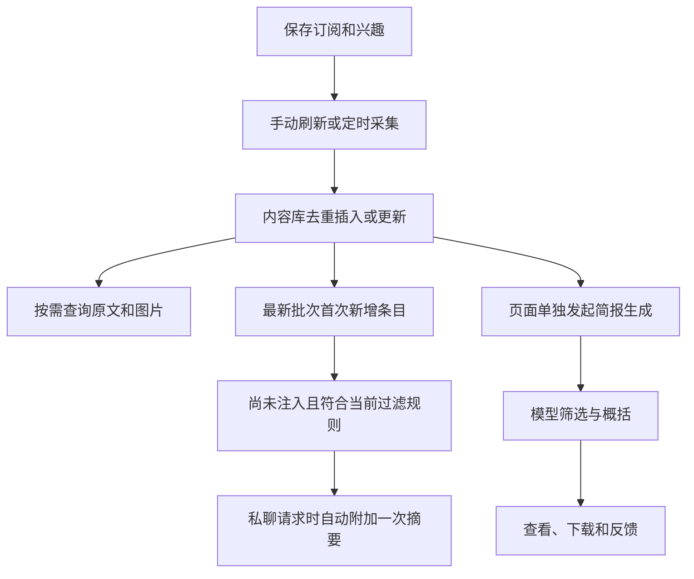

# B站拾讯

**在 AstrBot 里搜索 B 站、订阅更新，让新内容进入你的聊天上下文。**


免登录搜索视频，订阅关键词、UP 主和自己的关注，按来源与时间查询已采集内容，也可以按兴趣生成个人简报。直接使用 B 站接口，无需 RSSHub、独立采集服务或额外模型密钥。

[快速开始](#快速开始) · [使用指南](#使用指南) · [配置](#配置) · [常见问题](#常见问题) · [隐私说明](PRIVACY.md) · [更新记录](CHANGELOG.md)

## 功能

- **聊天搜索**：直接说出想找的主题，匿名搜索视频，无需先创建订阅。
- **长期订阅**：采集关键词搜索、UP 投稿与动态、自己的关注；支持手动刷新和定时采集。
- **新增内容上下文**：只把最新批次首次入库、尚未注入的条目带入聊天，同一内容只自动注入一次。
- **原文检索**：按来源、时间和关键词读取本地内容，保留作者、链接及转发归属，按需查看正文和图片。
- **个人简报**：复用 AstrBot 模型按兴趣挑选内容，支持反馈、偏好学习、历史查看和 Markdown 下载。
- **用户独立档案**：每位用户拥有自己的订阅、登录、内容库、任务与反馈，页面可管理绑定的管理员档案。

## 兼容性

- **AstrBot**：当前元数据限定 `==4.29.1`，其他版本尚未验证。
- **平台**：OneBot/aiocqhttp、QQ 官方 WebSocket、QQ 官方 Webhook，均仅支持私聊；官方机器人限 C2C。
- **模型**：聊天工具需要在所用人格中启用，并由支持工具调用的聊天模型使用；简报复用 AstrBot 已配置的模型。
- **运行环境**：开发与回归环境为 Python 3.12，运行依赖见 [requirements.txt](requirements.txt)。

当前通过仓库源码安装，尚未提交插件市场。`main` 可能包含未发布功能，安装或更新前可查看 [CHANGELOG.md](CHANGELOG.md)。QQ 官方适配已有离线事件与消息测试，真实账号权限、平台审核及消息送达仍需在部署环境确认。

## 快速开始

### 1. 安装插件

在 AstrBot 插件管理中，使用本仓库地址安装：

```text
https://github.com/yuease/astrbot_plugin_bilibili_shixun
```

也可以在 AstrBot 项目根目录手动克隆：

```bash
git clone https://github.com/yuease/astrbot_plugin_bilibili_shixun.git data/plugins/astrbot_plugin_bilibili_shixun
```

依赖应安装在 **AstrBot 使用的 Python 环境**中，由宿主处理 [requirements.txt](requirements.txt)。安装后加载插件，并在所用人格中启用本插件工具。

### 2. 先试一次免登录搜索

私聊机器人：

> 去 B 站搜索天文科普视频，不要加入长期订阅。

普通私聊用户默认可使用公开搜索和个人关键词订阅，无需扫码。搜索成功后，可以继续要求查看某条内容的详情。

### 3. 创建长期订阅并采集

> 把“天文”加入我的长期关键词，开启关键词订阅，然后刷新来源。

保存设置与刷新采集是两个独立操作。需要自动采集时，在插件页面开启采集计划，可选间隔为 30、60、120、360 分钟。

### 4. 按需连接 B 站账号

使用 UP 或关注来源前，在私聊发送 `/B站登录`，使用 B 站 App 扫码确认。账号托管默认仅管理员可用，管理员可在插件配置中调整。

登录后可以说：

> 开启我的关注视频并刷新，看看今天更新了什么。

登录不会自动开启关注订阅。新增 UP 主可在插件页面操作。

### 5. 绑定管理页面

1. 将目标用户设为 AstrBot 管理员，让该用户私聊发送一次 `/B站状态` 建立档案，无需先扫码。
2. 在插件配置 `dashboard_bindings` 中填写管理员 QQ 号或该命令返回的 SID。
3. 重载插件，打开“B站拾讯”插件视图，管理来源、兴趣、过滤规则、采集计划及简报。

OneBot 通常填写 QQ 号，QQ 官方机器人建议直接填写 SID。同一个 QQ 号出现在多个机器人实例时，也应使用完整 SID，例如 `mybot:FriendMessage:123456789`。

所有获准的 Dashboard 账号管理同一个绑定档案。普通用户的私聊档案仍独立，页面不会根据 Dashboard 用户名另建内容库。

## 使用指南

### 聊天示例

| 想做的事 | 可以这样说 |
| --- | --- |
| 临时找视频 | 去 B 站搜索摄影入门视频，不要订阅。 |
| 管理关键词 | 把“摄影”加入长期关键词，兴趣改成偏实操的入门教程。 |
| 刷新订阅 | 刷新我的来源，告诉我哪些来源采集成功了。 |
| 查询更新 | 今天关注的 UP 更新了什么？ |
| 调整关注范围 | 把我的关注改成综合动态，然后刷新。 |
| 查看原文或图片 | 打开刚才第二条的正文，再把它的第一张原图发给我。 |
| 暂停已有来源 | 暂停 UID 123 的 UP 订阅。 |

长期关键词最多五个。修改设置时会校验版本，避免覆盖页面或其他请求刚保存的变更，重复请求不会重复修改。误改后可让 Bot 撤销对应变更；后续同字段已被修改时，会拒绝覆盖。

### 采集、查询与简报



- **采集**：把已启用来源的内容保存到本地，不调用筛选模型；任务结束不代表全部更新已取完。
- **查询**：读取本地保留内容，不会自动联网补齐，也不额外调用筛选模型。寻找新内容需显式刷新或使用临时联网搜索。
- **简报**：在页面单独发起，从当前可用候选中按兴趣挑选；有候选时进行一次逻辑模型调用，失败不自动重复调用。

临时搜索默认返回五条，最多十条，远端可显式选择第 1–3 页；结果保留 24 小时，不自动加入长期订阅。刷新与临时搜索均在后台执行，等待超时不会取消任务，Bot 可继续查询任务状态。

### 新增内容如何带入聊天

默认开启，规则如下：

1. 只处理**最新一轮已完成的订阅采集**，按当前用户与 B 站账号范围内的统一内容 ID 判断首次入库。
2. 旧内容再次采到、正文更新，或同一内容出现在另一个来源中，都不算新增。
3. 重新应用当前来源开关和过滤规则，按发布时间由新到旧展示；每次最多八条，每条原文节选最多 280 字符，总长度默认不超过 6000 字符。
4. 选入摘要的条目写入持久化已注入记录，并发聊天、重新开聊及重载插件后不重复带入。同一请求重复执行钩子保留原摘要。
5. 未展示的条目不提前消费，在该批次仍为最新批次时可随后续请求继续带入；出现新批次后，不补发旧批次。

没有新增、全部已注入、后台任务运行中、最新采集失败，或长度限制下放不下任何条目时，不附加摘要。临时联网搜索结果不参与自动注入。

摘要直接提取已采集文字，包含标题、作者、时间、原文节选与链接。它会占用当前聊天请求的输入上下文，但不额外调用总结模型，也不向聊天历史追加永久消息。注入后即记为已使用，不以模型回答成功为条件，后续需要时仍可查询本地原文。

### 登录与退出

| 命令 | 作用 |
| --- | --- |
| `/B站登录` 或 `/B站登陆` | 私聊获取二维码，使用 B 站 App 扫码确认。 |
| `/B站状态` | 查看本人登录状态、账号 UID、SID 与托管权限。 |
| `/B站退出` | 清除本人保存在插件中的登录凭据和通知绑定。 |

首次扫码前，插件会说明凭据将保存在机器人服务器上。请只在信任服务器运营者时扫码。二维码在内存中生成，不交给模型处理；退出不会删除历史内容，也不会退出 B 站其他设备。

OneBot 支持在确认登录失效后，向绑定私聊自动发送一轮新二维码。QQ 官方机器人采用用户触发的被动回复，失效后在下次使用时提示重新登录；`bili_auto_relogin` 不会为官方机器人开启后台推送。超时、限流和风控不会被直接当作登录失效。

## 配置

以下是 **AstrBot 插件配置项**，修改后重载插件。关键词、兴趣和已有来源启停可通过聊天管理；新增 UP、过滤规则及采集计划在插件页面设置。

### 访问与账号

| 配置项 | 默认值 | 说明 |
| --- | --- | --- |
| `allow_private_users` | `true` | 允许普通私聊用户使用；关闭后仅当前会话配置中的管理员可用，群聊始终禁用。 |
| `account_hosting_admin_only` | `true` | 仅管理员可扫码托管账号及使用登录来源；关闭后获准私聊用户可托管自己的账号。 |
| `max_users` | `32` | 档案数量上限，范围 1–128；达到上限后拒绝新档案，保留已有档案。 |
| `dashboard_bindings` | `""` | 页面固定管理的管理员 QQ 号或 SID；留空时页面提示需要绑定。 |
| `dashboard_admins` | `[]` | 获准使用页面的 Dashboard 用户名；留空使用宿主默认 Dashboard 用户名。 |
| `bili_auto_relogin` | `true` | OneBot 登录失效时自动向已绑定私聊发送二维码。 |
| `bili_check_interval_minutes` | `30` | 登录状态检查间隔，范围 5–1440 分钟。 |

### 摘要与模型

| 配置项 | 默认值 | 说明 |
| --- | --- | --- |
| `collection_context_enabled` | `true` | 自动带入最新批次首次新增条目，每条仅一次。 |
| `collection_context_max_chars` | `6000` | 每次附加摘要的总字符上限，范围 1000–20000；不是 token 数。 |
| `briefing_provider_id` | `""` | 简报模型 ID；留空使用所属私聊当前使用的 AstrBot 模型。 |
| `model_timeout_seconds` | `90` | 简报模型等待上限，范围 10–300 秒。 |

例如，只允许管理员使用，并把页面绑定到指定私聊：

```json
{
  "allow_private_users": false,
  "account_hosting_admin_only": true,
  "dashboard_bindings": "mybot:FriendMessage:123456789"
}
```

请替换为 `/B站状态` 返回的实际 SID。页面只能绑定管理员，不能用页面绑定绕过账号托管或私聊访问权限。

## 数据与隐私

个人档案按“平台适配器 + 机器人实例 ID + 用户 ID”隔离。切换人格或重新开聊沿用原档案，不同用户即使登录同一个 B 站 UID，也不共享内容、凭据和反馈。切换 B 站账号后按账号范围读取，旧账号数据不会自动转为公开数据。

```text
data/plugin_data/astrbot_plugin_bilibili_shixun/
└── users-v1/
    └── <个人档案哈希>/
        ├── identity.json                # 所属用户身份
        ├── briefing_profile.json        # 订阅、兴趣与采集设置
        ├── account/                    # 可选的登录凭据及通知绑定
        └── workspace/                  # 内容数据库与简报文件
```

联网搜索会把搜索词发送给 B 站。聊天工具结果、自动附加的新增摘要及生成简报所需内容会发送给相应 AstrBot 模型，登录凭据不作为这些内容的一部分发送给模型。

服务器运营者仍可访问磁盘文件，用户隔离不表示数据已加密。完整的凭据保存、退出、备份及删除说明见 [PRIVACY.md](PRIVACY.md)。旧版 `runtime/`、`runtime-v2/` 等共享目录不自动读取或迁移。

## 常见问题

### 为什么保存了订阅，还查不到内容？

保存、采集和查询分别执行。保存后需要刷新来源；若刚新增关键词，还应确认关键词来源已开启。来源状态可区分尚未采集、采集失败、成功但为空，以及仍在使用旧快照的情况。

### 为什么机器人没有自动介绍刚采集的内容？

摘要在后续私聊请求模型时附加，不会在采集完成时主动发送消息。它只包含最新批次首次新增、尚未注入的条目，已存在内容不会因刷新再次注入。模型按当前话题使用资料，无关话题不要求主动播报；需要确认时，可直接要求查询本地更新。

### 页面提示未绑定或绑定有歧义怎么办？

先确认目标用户属于 AstrBot 管理员，并已私聊发送 `/B站状态`。将完整 SID 填入 `dashboard_bindings` 后重载。官方机器人的 OpenID 不是 QQ 号；同一号码在多个实例中出现时，完整 SID 可以消除歧义。

### 为什么任务完成了，仍提示覆盖不完整？

采集受分页、请求次数、时间预算和接口返回范围限制。任务完成只说明这一轮已结束，查询读完也只代表本地结果已读完。来源状态会保留扫描范围、停止原因和失败信息，不据条数推断远端全部内容已取完。

### QQ 官方机器人显示图片已提交，手机却没收到？

已提交只表示内容交给宿主适配器，插件无法据此证明用户实际收到。图片审核、频控、平台权限及链接域名配置需要在 QQ 平台和宿主环境排查，插件不会因送达不确定而自动重发。

### 会识别图片、观看视频或操作 B 站账号吗？

插件使用已采集的文字与元数据，不识图、不声称观看视频。图片由用户明确要求后按条目发送，默认原图。B 站接口用途限于内容读取和登录，不提供点赞、评论或发动态操作。

## 开发

### 目录结构

```text
main.py              AstrBot 入口、聊天工具、请求钩子与页面接口
core/                内容模型、采集、检索、过滤、存储与简报逻辑
services/            用户隔离、账号登录、任务调度、模型和图片服务
views/               插件管理页面
tests/               离线回归与浏览器测试
scripts/             源码安装包构建
docs/                使用细节、设计说明与历史验收记录
```

### 本地验证

使用 Python 3.12 创建并激活开发虚拟环境，在仓库根目录执行：

```bash
python -m pip install -r requirements-dev.txt
python -m playwright install chromium
python -m pytest -q tests
node --test tests/test_gui_sync.cjs
python -m ruff check .
python -m ruff format --check main.py core services scripts tests
```

页面逻辑测试需要 Node.js。浏览器测试使用 Playwright Chromium，也可通过环境变量 `SHIXUN_BROWSER_CHANNEL=msedge` 指定已安装的 Edge。开发依赖不进入生产安装包。

2026-10-28 最近一次 Python 完整回归为 **189 项通过**，覆盖新增条目识别、一次性注入、并发与重载、用户和账号隔离、登录、检索、页面及安装包检查。测试使用模拟的 B 站、QQ 传输和模型响应，页面测试运行真实浏览器；该结果不代表真实 QQ 收发或线上 B 站接口已经验收。历史验证范围见 [docs/VERIFICATION.md](docs/VERIFICATION.md)。

### 构建与更新

```bash
python scripts/build_release.py --output dist/astrbot_plugin_bilibili_shixun-source.zip
```

构建脚本按白名单打包源码，排除开发环境、测试、账号凭据和运行数据库。安装包放在本地 `dist/`，不表示已经创建 GitHub Release 或提交插件市场。

从 Git 克隆安装的实例，可在 AstrBot 项目根目录更新源码后重载插件：

```bash
git -C data/plugins/astrbot_plugin_bilibili_shixun pull --ff-only
```

更新前阅读 [变更记录](CHANGELOG.md)，并备份个人数据。历史安装包不一定包含 `main` 上的最新改动。

## 文档与反馈

- [工具与行为参考](docs/USAGE.md)：十个聊天工具、来源覆盖、分页、图片和附件规则。
- [个人数据与隐私](PRIVACY.md)：凭据保存、模型数据、退出与数据删除。
- [更新记录](CHANGELOG.md)：功能变更及兼容性调整。
- [设计与实现](docs/IMPLEMENTATION.md)：实现说明，历史文档中的版本行为以当前代码为准。
- [问题反馈](https://github.com/yuease/astrbot_plugin_bilibili_shixun/issues)：请附 AstrBot 版本、适配器、复现步骤及脱敏日志，不要提交 Cookie、二维码或账号凭据。

## 来源与许可

感谢 [bilibili-api-python](https://github.com/Nemo2011/bilibili-api)、[dsh-bili-scroll](https://github.com/c1overzz/dsh-bili-scroll) 和同作者的 [info-agent](https://github.com/yuease/info-agent)。依赖、登录流程参考及领域代码来源见 [SOURCE.md](SOURCE.md)。

**本仓库当前尚未声明项目许可证。** 依赖与参考项目的许可分别说明，不以它们的许可证代替本项目的许可声明。
